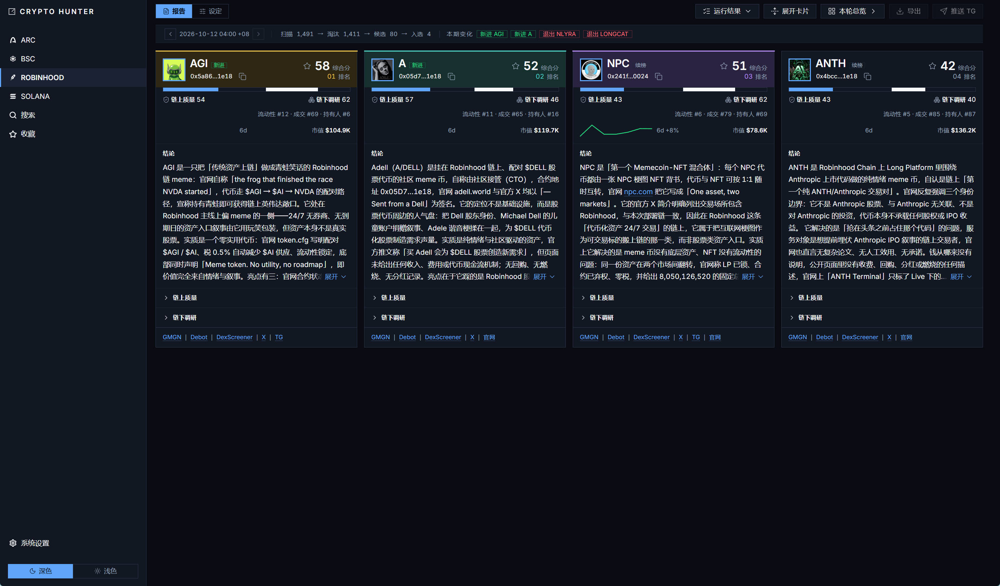
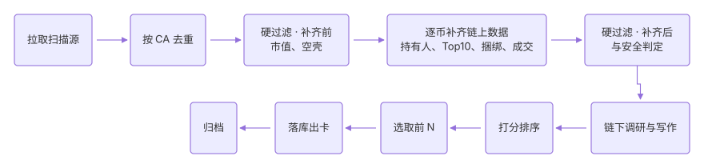

# Crypto Hunter

数据 + AI 驱动的加密雷达：按链扫描全量代币，按市值、流动性、成交、筹码与安全等规则逐轮淘汰，通过的代币交由 AI 完成链下调研（读取官网、X 与 GitHub等）并产出词条再与链上质量合成综合分，输出研究卡片。本项目不涉及交易、信号、实时行情、多用户与回测，不构成任何投资建议。



更多产品功能见 [assets](assets/)

## 一、技术架构

| 技术 | 职责 |
| --- | --- |
| Python 3.13 / FastAPI | HTTP 接口与一轮编排；同时托管 `web/dist`，单进程 8787 |
| SQLite（WAL） | 报告、快照、设定版本与词条的存储 |
| httpx / curl-cffi | 数据源抓取（GMGN 需要 TLS 指纹，走 curl-cffi） |
| Playwright | 渲染仅 JavaScript 执行后才有内容的页面（无头 Chromium，作为兜底） |
| twitter-cli（外部 CLI） | 挖外链：X 高级搜索走 subprocess，不消耗 token |
| OpenAI 兼容网关 | 链下调研与写作（词条与结论） |
| React 19 / TypeScript / Vite | 前端界面与构建 |
| TanStack Query | 页面数据获取与缓存 |

## 二、工作方式



当前接入四条链：Arc、Robinhood、Solana、BSC。每条链可配置多套设定，各对应独立的报告库，同一时刻只有一套生效。

## 三、本地运行

前置：Python + Node.js + npm

```
cd api; uv run python -m app       # 后端 127.0.0.1:8787，同时托管 web/dist
cd web; npm install; npm run dev   # 前端开发服务器 5173，/api 代理到 8787
```
启动后访问 http://127.0.0.1:8787

## 四、系统设置

必须配置 LLM 网关与 X 会话 cookie。配置写在 `config/system.yaml`（不入库，模板见 `config/system.yaml.example`），或在左栏最下方的系统设置页修改；修改在下次调用时生效，无须重启。
- LLM 网关（OpenAI 兼容）: 必须填写，载入LLM模型用于链下调研与写作，否则无实质调研报告
- X 会话 cookie: 至少一条，用于高级搜索查找代币官网/X/GitHub等，否则无法从X获取信息。可以配多条（每条一个平级账号），一条 = 一条并行 lane：3 条约 3 倍采集速度，某条 429 冷却、401 停用都不影响其它条

> 请使用X测试账号不要使用主力账号，此方式会导致账号被封但仍可通过高级请求获取X数据

更多项目细节，参考 [CLAUDE.md](CLAUDE.md)
