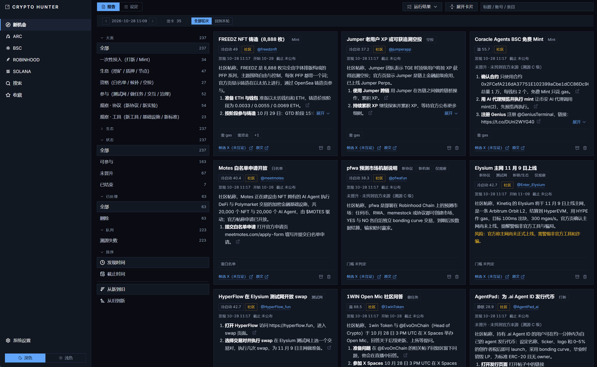
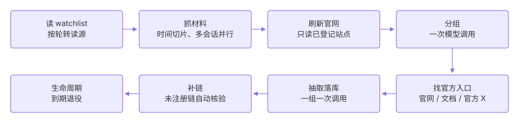

# Crypto Hunter

Crypto Hunter 是一个用 AI 发现与筛选优质链上加密项目的研究工具，不涉及交易、信号、实时行情、多用户与回测等行为，不构成任何投资建议。

- **新机会**：只读 X，从信息流中筛出可参与的机会，如打新、挖矿、空投、测试网、新协议等；每条整理成一张卡片，写明做什么、需要什么、何时截止。
- **币种筛选**：把每条链上的代币逐轮筛出数十个，每个配一份两分钟内可读完的研究卡片：项目在做什么、链上数据如何、风险在哪，证据链接附在卡上。



## 一、技术架构

| 技术 | 职责 |
| --- | --- |
| Python 3.13 / FastAPI | 接口与一轮编排，同时托管 `web/dist`，整站单进程 8787 |
| SQLite（WAL） | 报告、快照、词条与设定版本的存储 |
| httpx / curl-cffi | 抓数据源；GMGN 需要 TLS 指纹，走 curl-cffi |
| Playwright | 纯 JS 渲染的页面用无头 Chromium 兜底 |
| twitter-cli（外部 CLI） | X 高级搜索走子进程，不消耗模型 token |
| OpenAI 兼容网关 | 链下调研与写作 |
| React 19 / TypeScript / Vite | 前端界面与构建 |
| TanStack Query | 页面数据获取与缓存 |

## 二、本地运行

前置：Python 3.13（由 uv 管理）、Node.js 与 npm。

```
cd api; uv run python -m app       # 后端 127.0.0.1:8787，同时托管 web/dist
cd web; npm install; npm run dev   # 前端开发服务器 5173，/api 代理到 8787
cd web; npm run build              # 改完前端后构建，生产页面（web/dist）才会更新
```

启动后访问 http://127.0.0.1:8787

## 三、新机会

只读 X，不做链上扫描，也不写 `runs`。



- **范围**：打新、挖矿、空投、测试网任务等可参与的机会，以及新出现的协议与工具；CEX 营销、纯新闻、招聘、交易赛、游戏 / AMA / 派对在闸上就被排除（前几类靠查询与免费闸，游戏与 AMA / 派对还要在抽取时按卡片文字再筛一次）。
- **流程**：八段——读 watchlist → 抓材料 → 刷新官网 → 分组 → 找官方入口 → 抽取落库 → 补链 → 生命周期。帖子仅作线索，官网、文档和官方 X 为事实源；分组与抽取各调用一次模型，官网未写的内容不补。
- **页面**：报告按轮次、大类、生态、状态筛选，左侧队列按阶段列出排队中的条目。

## 四、币种筛选

从一条链的全量代币中逐轮筛出数十个，每个附一份两分钟内可读完的研究卡片。


- **范围**：四条链——Arc、Robinhood、Solana、BSC；每条链可有多套设定，各自对应独立的报告库，同一时刻仅一套生效。
- **流程**：九段——拉取扫描源 → 按 CA 去重 → 硬过滤（市值、空壳）→ 逐币补齐链上数据 → 硬过滤与安全判定 → 链下调研与写作 → 打分排序 → 选取前 N → 落库出卡。
- **卡片**：综合分由链上分项与链下词条合成，附 GMGN、Debot、DexScreener、X、官网等证据链接；未取到的值视为未知，既不计通过也不计淘汰，不以 0 或空串替代。

## 五、配置

必须配置 LLM 网关与至少一条 X 会话 cookie。配置文件为 `config/system.yaml`（不入库，模板见 `config/system.yaml.example`），也可在左栏「系统设置」页修改；修改在下次调用时生效，无需重启，保存前会将旧文件备份为 `system.yaml.bak`。

- **LLM 网关**（OpenAI 兼容）：必填，链下调研与写作均依赖它，缺失时无法生成研究报告。
- **X 会话 cookie**：至少一条，高级搜索用于查找官网、X 与 GitHub；可配置多条，每条对应一个并行 lane，三条约为三倍采集速度；某条 429 冷却十分钟、401 停用，均不影响其它条。
- **日志**：`/api/v1/system/log`，可直接在浏览器打开。

> 请使用 X 测试账号，不要使用主力账号：该方式存在封号风险，但仍可通过高级请求读取 X 数据。

## 六、文档

- `CLAUDE.md`：架构、约定与维护规则，改代码前先读。
- 模块文档：`api/app/api/v1/README.md`、`api/app/pipeline/README.md`、`api/app/report/README.md`、`api/app/search/README.md`、`api/app/opportunity/README.md`、`api/app/store/README.md`、`web/src/features/README.md`、`web/src/styles/README.md`。
